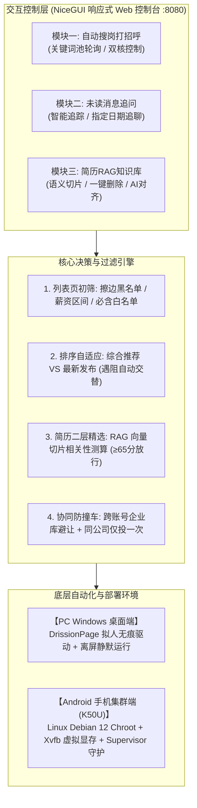

# BOSS直聘智能全自动求职与打招呼系统 (BossAutoGreet v6.2)

<div align="center">


**专为求职者打造的工业级、低风控、拟人化智能求职辅助平台**  
**集成 RAG 简历知识切片、双号协同防撞车、多维黑白名单过滤矩阵与 Android 手机 24 小时保活集群部署**

</div>

---

## 🏛️ 系统架构图



---

## 🌟 核心功能特性

### 1. 🛡️ 双号防撞车与公司防轰炸机制
* **跨账号保护避让**：当账号一向某企业 HR 发起沟通后，账号二在全国检索中自动将其列为保护避让目标并跳过，杜绝双号同时轰炸同一企业；
* **同公司仅投一次限制**：同一家企业仅联系一位最高契合度 HR，捍卫专业求职形象。

### 2. ⚡ 搜岗排序自适应切换 (最新发布 VS 综合推荐)
* **最新发布优先**：第一时间触达在线招聘者，抢占面试先机；
* **综合推荐优先**：结合官方算法推荐流，兼顾职位相关度与热度；
* **遇阻自动交替**：连续遇到不合适岗位时自动翻转排序策略，深度挖掘长尾岗位。

### 3. 📄 简历 RAG 知识切片库与资料管理
* **多格式解析与中文切片**：支持上传 PDF、Word、TXT、Markdown，自动抽取技术栈实体、工作年限与意向方向并建立语义知识库；
* **已入库资料管理列表**：清晰展示入库时间、切片块数与生效状态，支持**一键彻底删除已入库简历与对应 RAG 切片**；
* **DeepSeek 偏好对齐**：支持通过自然语言微调求职偏好，自动生成个性化过滤规则。

### 4. 🔍 多层级严密过滤矩阵
* **列表页初筛**：内置百余项外包公司、转培训机构、虚假擦边岗位黑名单；
* **HR 活跃度硬性校验**：自动识别“在线”、“刚刚活跃”、“今日活跃”，剔除数月未登录的僵尸岗位；
* **拟人化防封策略**：随机动态滑动时延（`6~10s`）、每沟通 N 岗位长休机制、独立端口用户数据隔离。

### 5. 📱 Android 手机 (Redmi K50 Ultra) 24小时集群保活
* 依托 KernelSU 与 Debian 12 ARM64 Chroot 容器，配合 Xvfb 虚拟帧缓冲，实现**手机端无桌面后台全天候稳定投递**，硬件级锁电 50% 防电池鼓包。

---

## 📁 项目目录结构

```text
boss_auto_greet/
├── app.py                     # 系统核心主程序 (NiceGUI 界面 + 自动化调度中枢)
├── rag_engine.py              # RAG 知识切片引擎、偏好学习与 SQLite 持久层
├── city_data.py               # 全国省市区联动字典与城市编码表
├── config.example.json        # 用户配置示范模板 (脱敏)
├── requirements.txt           # Python 核心依赖清单
├── run.bat                    # Windows 一键独立启动脚本
├── 一键运行(后台静默免黑框版).vbs # Windows 静默后台运行脚本
├── deploy_k50u/               # Redmi K50 Ultra / Linux 手机容器专属部署包
│   ├── 1_setup_debian.sh      # Debian 容器依赖与 Chromium 运行垫片一键初始化
│   ├── 2_ksu_boot_service.sh  # KernelSU 开机自动保活自启服务
│   ├── boss_bot.conf          # Supervisor 进程守护配置文件
│   └── DEPLOY_GUIDE.md        # 手机端详细部署与排障指南
└── data/                      # 知识库与数据存放目录
    └── sample_resume_template.md # 样例脱敏简历模板
```

---

## 🚀 快速启动指南

### 方式一：Windows PC 本地运行

1. **环境准备**：确保已安装 Python 3.10+ 与 Chrome 浏览器；
2. **克隆项目与安装依赖**：
   ```bash
   git clone https://github.com/your-username/BossAutoGreet.git
   cd BossAutoGreet
   pip install -r requirements.txt
   ```
3. **初始化配置文件**：
   ```bash
   copy config.example.json config.json
   ```
4. **启动服务**：
   * 双击运行 `run.bat`，系统将自动检查依赖并在浏览器中打开控制台：👉 **http://127.0.0.1:8080**；
   * 初次使用在网页端点击扫码登录即可，Cookie 会自动持久化在本地。

---

### 方式二：Redmi K50 Ultra / Linux 手机端部署

详细步骤请参阅 👉 [deploy_k50u/DEPLOY_GUIDE.md](deploy_k50u/DEPLOY_GUIDE.md)。

---

## ⚠️ 免责声明与使用准则

1. 本项目仅供 Python 自动化技术学习、RAG 知识库工程实践与个人合理求职辅助使用；
2. 请严格遵守平台使用协议，合理设置每日打招呼上限（建议每日 ≤ 100~150 次）与沟通间隔，切勿滥用或用于恶意高频骚扰；
3. 本项目开源遵守 MIT 协议，开发者不对使用过程中因不当操作或平台策略变动产生的任何风险负责。
